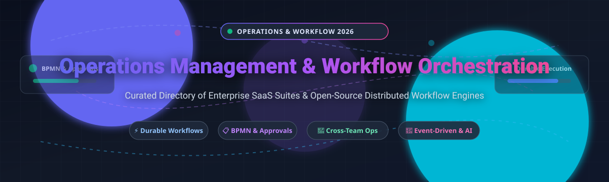
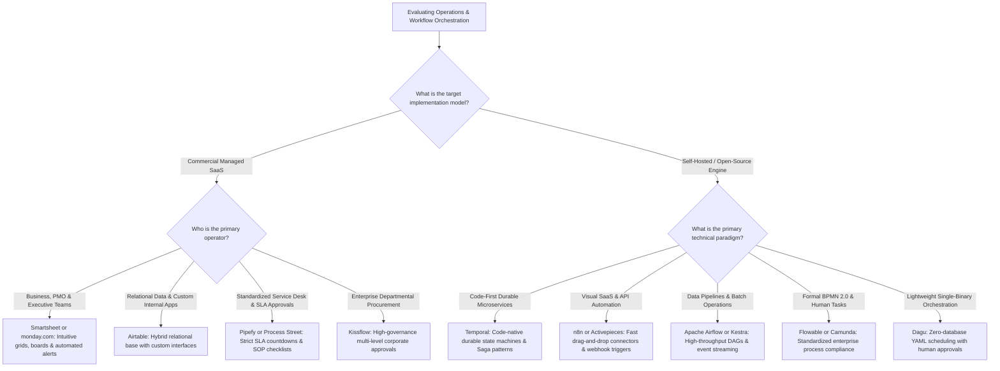

# 🚀 Awesome Operations Management & Workflow Orchestration ⚙️

> 🌟 **A curated, comprehensive directory of top Operations Management and Workflow Orchestration platforms** — encompassing commercial SaaS work management suites and production-ready open-source workflow engines for standardizing cross-functional processes, executing durable distributed jobs, automating human-in-the-loop approvals, and orchestrating enterprise operations. 🌟

---

## 📑 Table of Contents

- [🌐 Overview & Strategic Architecture](#-overview--strategic-architecture)
- [📈 Sector Overview & Market Dynamics](#-sector-overview--market-dynamics)
- [🟦 Commercial SaaS & Hosted Work Management Platforms](#-commercial-saas--hosted-work-management-platforms)
  - [SaaS Platforms Comparison Matrix](#-saas-platforms-comparison-matrix)
  - [Detailed SaaS Platform Profiles](#-detailed-saas-platform-profiles)
- [🟩 Open-Source Workflow & Orchestration Engines](#-open-source-workflow--orchestration-engines)
  - [Open-Source Solutions Comparison Table](#-open-source-solutions-comparison-table)
  - [Detailed Open-Source Profiles](#-detailed-open-source-profiles)
- [📊 Feature Matrix & Architectural Trade-Offs](#-feature-matrix--architectural-trade-offs)
- [🎯 Selection Guide: How to Choose](#-selection-guide-how-to-choose)
- [🤝 Contributing](#-contributing)
- [📄 License](#-license)

---

## 🌐 Overview & Strategic Architecture

Modern organizations face severe operational friction: fragmented data across SaaS tools, unstandardized human approvals, broken handoffs between cross-functional departments, and fragile script-based background jobs. 

**Operations Management & Workflow Orchestration platforms** resolve this fragmentation across two distinct operational paradigms:

1. 🏢 **Work Management & Human-Centric Operations (SaaS):** Provide visual Work OS interfaces, Kanban/Gantt boards, request intake forms, approval routing, and notification loops to organize team workflows without dedicated software engineering.
2. ⚙️ **Code-First & Distributed Process Orchestration (Open-Source):** Deliver durable state machines, BPMN 2.0 process standards, saga pattern compensation, retry loops, and event-driven automation across decoupled microservices and APIs.

---

## 📈 Sector Overview & Market Dynamics

> 💡 **Market Size & Growth Trajectory:** The global workflow orchestration, business process management (BPM), and IT operations management (ITOM) software market is estimated at **$16.2B to $19.4B in 2024–2025**, projected to surpass **$35.0B to $42.0B+ by 2030** at an annual compound growth rate (**CAGR of 10.5% to 13.3%**). Sub-segments driven by AI-agentic automation and durable distributed execution are expanding at higher rates exceeding 25% CAGR.
>
> ⚖️ **Market Structure & Fragmentation:** The sector is **moderately fragmented and dual-tiered**. The upper enterprise layer is anchored by mega-cap suites (ServiceNow, Atlassian, Smartsheet, monday.com) capturing corporate workflow budgets. Meanwhile, a vibrant, rapidly innovating ecosystem of specialized SaaS tools (Airtable, ClickUp, Pipefy) and high-velocity open-source platforms (n8n, Temporal, Airflow, Kestra) prevents a single "winner-take-all" outcome, providing flexible architectural choices across no-code business teams and code-first engineering organizations.

---

## 🟦 Commercial SaaS & Hosted Work Management Platforms

Commercial cloud-hosted platforms deliver turnkey, collaborative environments for cross-functional project tracking, operational intakes, and no-code business rules.

### 📊 SaaS Platforms Comparison Matrix

The table below is sorted in descending order by company scale (**Market Capitalization / Valuation / ARR**):

| Rank | Platform | Company Scale (Valuation / Market Cap / ARR) | Starting Tier Pricing | Free Plan Limit / Free Trial Limit | Primary Focus & Capabilities |
|:---:|---|---|---|---|---|
| 1 | **[monday.com](https://monday.com)** | **~$14.5 Billion** (Public: NASDAQ `MNDY`, ~$950M+ ARR) | **$9.00** / seat / month (Basic, billed annually; 3-seat min = $27/mo) | **Free Forever:** Up to 2 seats, 3 boards, 200+ templates, 500MB storage, unlimited docs | Work OS with visual customizable boards, dashboards, and automated status triggers |
| 2 | **[Smartsheet](https://www.smartsheet.com)** | **~$8.4 Billion** (Acquired / Take-private 2024, ~$1.1B ARR) | **$9.00** / member / month (Pro, billed annually; max 10 members) | **30-day Free Trial:** Full access to automated workflows, sheets, reports, and Gantt charts; up to 10 users | Grid & spreadsheet-first operations with automated alerts, approvals, and update requests |
| 3 | **[Airtable](https://airtable.com)** | **~$11.7 Billion** (Valuation, Series F; ~$300M+ ARR) | **$20.00** / seat / month (Team, billed annually) | **Free Forever:** Up to 5 creators/editors, 1,000 records/base, 1GB attachments/base, 100 automation runs/mo | Relational database hybrid with custom app interfaces and trigger-action automations |
| 4 | **[Asana](https://asana.com)** | **~$3.2 Billion** (Public: NYSE `ASAN`, ~$700M+ ARR) | **$10.99** / user / month (Starter, billed annually) | **Free Forever:** Up to 10 teammates, unlimited tasks/projects, 100MB file storage, basic search | Task and project collaboration with timeline Gantt views and no-code automated rules |
| 5 | **[ClickUp](https://clickup.com)** | **~$4.0 Billion** (Valuation, Series C; ~$200M+ ARR) | **$7.00** / user / month (Unlimited, billed annually) | **Free Forever:** Unlimited free members, 100MB storage, unlimited tasks, 100 automation uses/mo | All-in-one productivity suite bundling docs, goals, sprints, whiteboards, and automations |
| 6 | **[Wrike](https://www.wrike.com)** | **~$2.25 Billion** (Acquired by STG, ~$200M+ ARR) | **$10.00** / user / month (Team, billed annually; 2-25 users) | **Free Forever:** Unlimited users, 2GB storage/account, web/desktop/mobile apps, basic task views | Work management featuring structured custom request intake forms and approval routing |
| 7 | **[Kissflow](https://kissflow.com)** | **~$500 Million** (Estimated Valuation / $50M+ ARR) | **$1,500.00** / month (Basic package, billed annually) | **14-day Free Trial:** Enterprise app evaluation via Solution Consultant guided sandbox; no permanent free tier | Low-code enterprise workflow engine for multi-level approval hierarchies and procurement |
| 8 | **[Pipefy](https://www.pipefy.com)** | **~$400 Million** (Valuation, Series C; $40M+ ARR) | **$20.00** / user / month (Business tier, billed annually) | **Free Forever:** Up to 10 users, 5 active pipes (processes), 500 records, 15 automation runs/mo | Process standardization with visual Kanban pipes, strict SLA tracking, and auto-escalation |
| 9 | **[Process Street](https://www.process.st)** | **~$150 Million** (Valuation, Series A / Accel & Salesforce backed) | **$100.00** / month (Startup tier for teams &lt;15 employees &amp; &lt;$2M rev) | **14-day Free Trial:** Full feature access including conditional logic, workflows, checklists, and 5 team seats | Checklist-driven operational procedures with conditional logic, approvals, and task assignments |

---

### 🔍 Detailed SaaS Platform Profiles

#### monday.com
* **Overview:** monday.com provides a flexible Work OS with customizable boards, automations, and executive dashboards. Positioned for operations teams wanting to build bespoke workflows without coding, it offers an intuitive visual drag-and-drop workspace.
* **Pricing & Limits:** Starts at **$9/seat/mo** (Basic, billed annually; minimum 3 seats = $27/mo). The **Free Forever** tier accommodates up to 2 seats, 3 boards, 200+ templates, and 500MB storage.
* **Best For:** Cross-departmental operational visibility, pipeline tracking, and rapid custom dashboard creation.

#### Smartsheet
* **Overview:** Smartsheet delivers a enterprise-grade spreadsheet-style work management system with automated business rules, Gantt timelines, resource management, and executive roll-up reporting.
* **Pricing & Limits:** Starts at **$9/member/mo** (Pro tier, annual billing, up to 10 members). Offers a **30-day Free Trial** with full capabilities; unlimited free viewers.
* **Best For:** Operations leaders and PMOs deeply comfortable with tabular data and multi-project financial tracking.

#### Airtable
* **Overview:** Airtable blends a relational database engine with interactive custom app builders, Kanban views, Gantt timelines, and modular integrations.
* **Pricing & Limits:** Starts at **$20/seat/mo** (Team tier, billed annually). The **Free Forever** plan includes up to 5 editors, 1,000 records per base, 1GB storage, and 100 monthly automation runs.
* **Best For:** Complex relational business operations, inventory catalogs, editorial calendars, and internal app prototyping.

#### Asana
* **Overview:** Asana focuses on team task coordination, structured project boards, timeline Gantt charts, workload balancing, and automated trigger-condition-action **Rules**.
* **Pricing & Limits:** Starts at **$10.99/user/mo** (Starter tier, billed annually). The **Free Forever** plan supports up to 10 users, unlimited tasks, and 100MB per file attachment.
* **Best For:** Agile operations teams requiring clear project ownership, dependencies, and milestone management.

#### ClickUp
* **Overview:** ClickUp positions itself as the "everything app for work", bundling tasks, shared docs, real-time whiteboards, goals, chat, and automated multi-step actions.
* **Pricing & Limits:** Starts at **$7/user/mo** (Unlimited tier, billed annually). The **Free Forever** tier provides unlimited team members, 100MB file storage, and 100 automation executions/month.
* **Best For:** Fast-growing teams and startups seeking high feature density and aggressive value-for-money.

#### Wrike
* **Overview:** Wrike excels in enterprise intake management, featuring dynamic request forms, automated multi-tier approval paths, customizable dashboards, and interactive Gantt charts.
* **Pricing & Limits:** Starts at **$10/user/mo** (Team tier, annual billing). The **Free Forever** plan supports unlimited users with basic task views and 2GB cloud storage.
* **Best For:** Mid-market and enterprise operations teams standardizing internal customer intake and client asset sign-offs.

#### Kissflow
* **Overview:** Kissflow provides a dedicated no-code/low-code workflow engine engineered for enterprise procurement, employee onboarding, invoice routing, and corporate governance.
* **Pricing & Limits:** Starts at **$1,500/month** (Basic tier). Offers a **14-day Free Trial** arranged via consultant evaluation; no permanent free tier.
* **Best For:** Enterprise business operations standardizing corporate governance and structured approval hierarchies.

#### Pipefy
* **Overview:** Pipefy provides structured Kanban-based process automation with pre-configured templates, SLA countdown enforcement, conditional request forms, and automated escalation triggers.
* **Pricing & Limits:** Starts at **$20/user/mo** (Business tier, annual billing). The **Free Forever** tier allows up to 10 users, 5 active pipes, 500 cards/records, and 15 automation runs/month.
* **Best For:** Centralized service desks, procurement ticketing, HR onboarding, and customer request resolution.

#### Process Street
* **Overview:** Process Street delivers interactive checklist-driven process automation with conditional logic, rich media attachments, multi-person sign-offs, and compliance audit histories.
* **Pricing & Limits:** Starts at **$100/month** (Startup tier for companies &lt;15 staff and &lt;$2M revenue). Offers a **14-day Free Trial** with full checklist functionality; no permanent free plan.
* **Best For:** Recurring operational procedures, compliance audits, franchise standard operating procedures (SOPs), and employee training checklists.

---

## 🟩 Open-Source Workflow & Orchestration Engines

Self-hosted, open-source workflow platforms offer unconstrained architectural flexibility, total data privacy, zero vendor lock-in, and native developer extensibility.

### 📊 Open-Source Solutions Comparison Table

The table below is sorted in descending order by GitHub repository popularity (**GitHub Stars** ⭐):

| Rank | Project | GitHub Stars Badge | Primary Stack | Core License | Engine Architecture & Signature Use Case |
|:---:|---|:---:|---|---|---|
| 1 | **[n8n](https://github.com/n8n-io/n8n)** |  | TypeScript / Node.js | Sustainable Use License | Canvas-based visual integration builder; 400+ nodes, webhooks, and AI agent extensions |
| 2 | **[Huginn](https://github.com/huginn/huginn)** |  | Ruby / MySQL | MIT License | Open-source self-hosted IFTTT/Zapier agent ecosystem for scraping, events, and automated alerts |
| 3 | **[Apache Airflow](https://github.com/apache/airflow)** |  | Python / Celery / K8s | Apache 2.0 | Programmatic Python DAG orchestrator; industry-standard batch data pipelines and ETL ops |
| 4 | **[Kestra](https://github.com/kestra-io/kestra)** |  | Java / Micronaut | Apache 2.0 | Declarative YAML-based event-driven orchestrator with microservice and data pipeline topologies |
| 5 | **[Activepieces](https://github.com/activepieces/activepieces)** |  | TypeScript / Angular | MIT License | Lightweight no-code visual workflow automation, 400+ community pieces, AI and MCP server support |
| 6 | **[Temporal](https://github.com/temporalio/temporal)** |  | Go / Multi-SDK | MIT License | Durable code-first execution platform; distributed transactions, Saga patterns, and infinite retries |
| 7 | **[Prefect](https://github.com/prefecthq/prefect)** |  | Python / Pydantic | Apache 2.0 | Python-native dynamic workflow orchestrator with granular task caching, state hooks, and web UI |
| 8 | **[Node-RED](https://github.com/node-red/node-red)** |  | JavaScript / Node.js | Apache 2.0 | Flow-based visual programming for wiring hardware devices, APIs, edge gateways, and IoT pipelines |
| 9 | **[Windmill](https://github.com/windmill-labs/windmill)** |  | Rust / Svelte / Python | AGPL 3.0 (Community) | Ultra-fast code-first developer platform turning scripts into internal endpoints, UIs, and workflows |
| 10 | **[Argo Workflows](https://github.com/argoproj/argo-workflows)** |  | Go / Kubernetes CRD | Apache 2.0 | Kubernetes-native container workflow engine for ML compute, parallel batch jobs, and CI/CD pipelines |
| 11 | **[Automatisch](https://github.com/automatisch/automatisch)** |  | JavaScript / React | AGPL 3.0 | GDPR-compliant self-hosted Zapier alternative for privacy-conscious internal automation |
| 12 | **[Flowable](https://github.com/flowable/flowable-engine)** |  | Java / Spring Boot | Apache 2.0 | Enterprise BPMN 2.0, CMMN, and DMN execution engine for human task approvals and case management |
| 13 | **[Dagu](https://github.com/yohamta/dagu)** |  | Go / YAML | GPL 3.0 | Zero-dependency single-binary orchestrator; declarative YAML DAGs with human-in-the-loop approvals |
| 14 | **[Camunda](https://github.com/camunda/camunda)** |  | Java / Zeebe | Apache 2.0 / Commercial | Scalable distributed process orchestrator; visual BPMN diagramming, decision tables, and Zeebe engine |
| 15 | **[Bonita](https://github.com/bonitasoft/bonita-engine)** |  | Java | GPL 2.0 (Community) | Full-stack digital process automation suite with integrated visual studio and end-user portal |

---

### 🔍 Detailed Open-Source Profiles

#### 1. n8n
* **GitHub Repository:** [`n8n-io/n8n`](https://github.com/n8n-io/n8n) | 
* **Stack:** TypeScript / Node.js | **License:** Sustainable Use License
* **Architectural Overview:** n8n is the most widely adopted fair-code workflow automation system. Its visual graph editor connects 400+ SaaS applications, database systems, webhooks, and modern AI/LLM components. While source-available and free for internal operational self-hosting, commercial OEM re-distribution requires a commercial agreement.
* **Best For:** Technical IT teams and developers wanting an extensible visual Zapier alternative with custom code nodes.

#### 2. Huginn
* **GitHub Repository:** [`huginn/huginn`](https://github.com/huginn/huginn) | 
* **Stack:** Ruby / MySQL | **License:** MIT License
* **Architectural Overview:** Huginn is an autonomous agent-based framework designed to monitor events on your behalf. Agents scan the web for changes, parse JSON feeds, emit structured notifications, and execute triggered actions across chat, email, and HTTP endpoints.
* **Best For:** Automated external event monitoring, web page change triggers, and scheduled data-scraping workflows.

#### 3. Apache Airflow
* **GitHub Repository:** [`apache/airflow`](https://github.com/apache/airflow) | 
* **Stack:** Python / Celery / Kubernetes | **License:** Apache 2.0
* **Architectural Overview:** Apache Airflow is the standard orchestrator for programmatic Directed Acyclic Graph (DAG) generation in Python. Backed by the Apache Software Foundation, it features battle-tested workers, an extensive provider catalog, backfilling support, and deep monitoring interfaces.
* **Best For:** Complex batch data engineering pipelines, scheduled machine learning jobs, and cross-warehouse ETL.

#### 4. Kestra
* **GitHub Repository:** [`kestra-io/kestra`](https://github.com/kestra-io/kestra) | 
* **Stack:** Java / Micronaut | **License:** Apache 2.0
* **Architectural Overview:** Kestra is an event-driven control plane and workflow orchestrator. Workflows are defined as declarative YAML schemas that run with ultra-low latency, supporting both scheduled batch executions and microsecond microservice API trigger events.
* **Best For:** Language-agnostic platform teams orchestrating cloud infrastructure, data pipelines, and internal business events.

#### 5. Activepieces
* **GitHub Repository:** [`activepieces/activepieces`](https://github.com/activepieces/activepieces) | 
* **Stack:** TypeScript / Angular | **License:** MIT License
* **Architectural Overview:** An open-source, permissive MIT-licensed automation platform designed as an enterprise-friendly Zapier alternative. It offers community-authored "pieces", sandboxed code runs, Model Context Protocol (MCP) server endpoints, and embedded automation builders.
* **Best For:** Teams wanting an entirely open-source (MIT) drag-and-drop automation platform suitable for internal apps and white-label embedding.

#### 6. Temporal
* **GitHub Repository:** [`temporalio/temporal`](https://github.com/temporalio/temporal) | 
* **Stack:** Go / SDKs in Go, Java, TypeScript, Python | **License:** MIT License
* **Architectural Overview:** Temporal is a durable execution platform where business logic is authored entirely as code. If servers crash, processes restart, or third-party APIs fail, Temporal seamlessly resumes state from event logs without manual intervention or data loss.
* **Best For:** Mission-critical distributed systems, financial transaction routing, and long-running Saga transactions.

#### 7. Prefect
* **GitHub Repository:** [`prefecthq/prefect`](https://github.com/prefecthq/prefect) | 
* **Stack:** Python / Pydantic | **License:** Apache 2.0
* **Architectural Overview:** Prefect provides a Python-native workflow orchestration framework based on function decorators (`@flow` and `@task`). It offers dynamic task creation, caching, automatic parameter validation, and asynchronous execution across distributed worker pools.
* **Best For:** Python developers and data scientists wanting code-native orchestration with minimal boilerplate.

#### 8. Node-RED
* **GitHub Repository:** [`node-red/node-red`](https://github.com/node-red/node-red) | 
* **Stack:** JavaScript / Node.js | **License:** Apache 2.0
* **Architectural Overview:** Originally built by IBM, Node-RED is a flow-based browser development tool for wiring hardware devices, API webhooks, industrial sensors, and online services together.
* **Best For:** Industrial IoT edge operations, hardware monitoring, and lightweight event routing.

#### 9. Windmill
* **GitHub Repository:** [`windmill-labs/windmill`](https://github.com/windmill-labs/windmill) | 
* **Stack:** Rust / Svelte / Python / TypeScript | **License:** AGPL 3.0 (Community)
* **Architectural Overview:** Windmill is a developer platform that turns raw Python, TypeScript, Go, Bash, or SQL scripts into production-ready endpoints, scheduled flows, and interactive auto-generated internal admin panels.
* **Best For:** Engineering teams automating DevOps playbooks, infrastructure scripting, and high-performance internal tools.

#### 10. Argo Workflows
* **GitHub Repository:** [`argoproj/argo-workflows`](https://github.com/argoproj/argo-workflows) | 
* **Stack:** Go / Kubernetes Custom Resource Definitions | **License:** Apache 2.0
* **Architectural Overview:** A CNCF graduated project implemented as a Kubernetes CRD. Each step in an Argo workflow runs as a native pod, offering parallelization, container isolation, and artifact tracking across Kubernetes clusters.
* **Best For:** Cloud-native Kubernetes teams orchestrating containerized machine learning pipelines and batch computing.

#### 11. Automatisch
* **GitHub Repository:** [`automatisch/automatisch`](https://github.com/automatisch/automatisch) | 
* **Stack:** JavaScript / React / Node.js | **License:** AGPL 3.0
* **Architectural Overview:** Automatisch provides a self-hosted visual workflow builder focused on user privacy and regulatory compliance (GDPR/HIPAA). It operates completely within your perimeter without relaying data through external clouds.
* **Best For:** Privacy-regulated European businesses and healthcare providers needing no-code integration flows.

#### 12. Flowable
* **GitHub Repository:** [`flowable/flowable-engine`](https://github.com/flowable/flowable-engine) | 
* **Stack:** Java / Spring Boot | **License:** Apache 2.0
* **Architectural Overview:** Created by the original authors of Activiti, Flowable is a compact, highly optimized BPM engine with comprehensive support for BPMN 2.0, CMMN 1.1, and DMN 1.2 standards. It integrates into Spring Boot applications for handling complex organizational hierarchies and multi-level approval matrices.
* **Best For:** Java enterprise teams building custom HR, procurement, and banking approval applications.

#### 13. Dagu
* **GitHub Repository:** [`yohamta/dagu`](https://github.com/yohamta/dagu) | 
* **Stack:** Go / YAML | **License:** GPL 3.0
* **Architectural Overview:** Dagu is a zero-dependency, local-first workflow orchestrator that runs from a single binary without requiring external databases. Workflows are declared in YAML with native support for shell commands, Docker containers, human-in-the-loop approvals, and Model Context Protocol (MCP) AI agents.
* **Best For:** Operations teams requiring a lightweight cron and task orchestrator with human approvals that runs anywhere without operational overhead.

#### 14. Camunda
* **GitHub Repository:** [`camunda/camunda`](https://github.com/camunda/camunda) | 
* **Stack:** Java / Zeebe Engine | **License:** Apache 2.0 / Commercial
* **Architectural Overview:** Camunda provides an enterprise process orchestration platform powered by Zeebe, a distributed, horizontally scalable workflow engine. It supports formal BPMN 2.0 modeling, decision tables (DMN), human task management, and end-to-end process observability.
* **Best For:** Large enterprises standardizing core operational processes with compliance auditing and formal BPMN governance.

#### 15. Bonita
* **GitHub Repository:** [`bonitasoft/bonita-engine`](https://github.com/bonitasoft/bonita-engine) | 
* **Stack:** Java | **License:** GPL 2.0 (Community)
* **Architectural Overview:** Bonita by Bonitasoft is a Digital Process Automation (DPA) suite combining a BPMN modeling studio, an execution engine, and a web portal for human actors to claim, execute, and monitor business activities.
* **Best For:** Traditional corporate IT teams seeking a bundled BPM platform with an integrated UI studio and portal.

---

## 📊 Feature Matrix & Architectural Trade-Offs

| System | Architecture Paradigm | Primary Audience | Visual Flow Builder | Durable State Storage | Human Tasks & Approvals | Community Ecosystem |
|---|---|---|:---:|:---:|:---:|:---:|
| **monday.com** | Proprietary SaaS | Operations & Business Teams | ✅ Kanban/Boards | Managed Cloud | ✅ Standard Checklists | Large Template Store |
| **Smartsheet** | Proprietary SaaS | PMOs & Operations Leads | ✅ Grid / Gantt | Managed Cloud | ✅ Approval Workflows | Enterprise Community |
| **Airtable** | Proprietary SaaS | Low-Code App Builders | ✅ Interface Studio | Managed Cloud | ✅ Trigger Automations | Extensive Extension Hub |
| **Asana** | Proprietary SaaS | Project Managers & Ops | ✅ Board / Timeline | Managed Cloud | ✅ Custom Rules | Enterprise Integrations |
| **ClickUp** | Proprietary SaaS | All-in-One Teams | ✅ Flexible Views | Managed Cloud | ✅ Approval Actions | Global Community |
| **Pipefy** | Proprietary SaaS | Service Desks & Operations | ✅ Pipe Cards | Managed Cloud | ✅ Native SLA Triggers | Standard Process Store |
| **n8n** | Self-Hosted / Fair-Code | Engineers & Automation Specialists | ✅ Node Graph Canvas | Postgres / SQLite | 🔄 Webhook / Form Nodes | 400+ Nodes |
| **Temporal** | Open-Source (MIT) | Distributed Systems Engineers | ❌ Code-Only (SDKs) | Cassandra / MySQL / PG | 🔄 Signal / Query APIs | Vibrant CNCF Community |
| **Apache Airflow** | Open-Source (Apache 2.0) | Data Engineers & Operations | ✅ Graph Inspection | PostgreSQL / MySQL | ❌ Batch Automation | Apache Foundation Ecosystem |
| **Kestra** | Open-Source (Apache 2.0) | Platform & DevOps Engineers | ✅ Interactive Topology | Kafka / PG / Elastic | 🔄 Pause / Resume Webhooks | Active GitHub Community |
| **Activepieces** | Open-Source (MIT) | Automation Engineers & SMBs | ✅ Step Builder | PostgreSQL | ✅ Form / Approval Steps | 400+ Modular Pieces |
| **Windmill** | Open-Source (AGPLv3) | Full-Stack Developers & DevOps | ✅ Flow Canvas & Code | PostgreSQL | ✅ Form Inputs & Scripts | Fast-Growing Dev Hub |
| **Flowable** | Open-Source (Apache 2.0) | Java Enterprise Architects | ✅ BPMN Modeler | Relational DB | ✅ BPMN User Tasks | Enterprise Java Base |
| **Dagu** | Open-Source (GPLv3) | SysAdmins & Ops Engineers | ✅ Web Flow UI | Local File / Zero DB | ✅ Native Approval Gates | Lightweight Dev Base |
| **Camunda** | Open-Source / Dual | Enterprise Process Architects | ✅ Camunda Modeler | Zeebe Event Log | ✅ Enterprise Tasklist | Global BPM Community |

---

## 🎯 Selection Guide: How to Choose

---

## 🤝 Contributing

Contributions are warmly welcomed! Help us keep this directory the most accurate, objective, and comprehensive guide for operations management and workflow orchestration:

1. 🍴 **Fork the repository**.
2. 🌿 **Create your branch**: `git checkout -b feature/awesome-addition`
3. ✍️ **Add your platform**: Include exact pricing tiers, free limits, verified stack, and accurate GitHub links.
4. 💾 **Commit changes**: `git commit -m 'Add platform to directory'`
5. 🚀 **Push to GitHub**: `git push origin feature/awesome-addition`
6. 📬 **Submit a Pull Request** with clear architectural context.

---

## 📄 License

This compilation is dedicated to the public domain under the [Creative Commons Zero v1.0 Universal](LICENSE) (CC0 1.0). All product names, logos, and brands remain trademarks of their respective owners.

⭐ **If you find this directory valuable for your operational architecture, please star the repo!** ⭐

